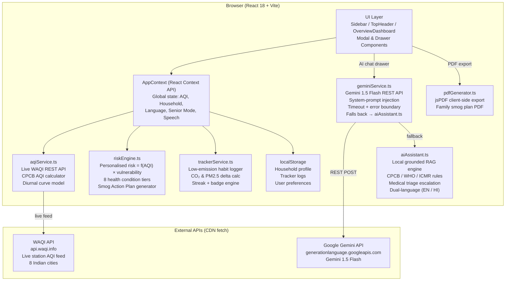

# BreatheWell — System Architecture

## Overview

BreatheWell is a client-side Progressive Web Application (PWA) built with React 18, TypeScript, and Vite. It provides India's urban families a hyper-local, personalized air quality intelligence dashboard using live CPCB/WAQI AQI data, a rule-based household risk engine, and Google Gemini 1.5 Flash for natural-language health guidance.

---

## Architecture Diagram



---

## Data Flow

### 1. App Initialisation
1. `AppProvider` mounts and reads `localStorage` for persisted household and tracker state.
2. `fetchAQIData()` in `aqiService.ts` fires a WAQI REST call with `AbortController` timeout (8 s).
3. On success, raw WAQI AQI is mapped to the CPCB 6-band scale and the diurnal hourly curve is generated.
4. `generateDailySmogPlan()` in `riskEngine.ts` builds per-member risk assessments and the top-level smog plan.
5. Polling repeats every 10 minutes.

### 2. Personalised Risk Engine
```
riskScore = baseAQIWeight(aqi) × conditionMultiplier(healthCondition) × ageModifier(age)
```
| Band | AQI Range | Base Weight |
|------|-----------|-------------|
| Good | 0–50 | 1.0 |
| Satisfactory | 51–100 | 1.3 |
| Moderate | 101–200 | 1.6 |
| Poor | 201–300 | 2.1 |
| Very Poor | 301–400 | 2.8 |
| Severe | 401–500 | 3.5 |

Condition multipliers: Asthma/COPD ×2.0 · Heart Disease ×1.9 · Pregnancy ×1.8 · Senior (60+) ×1.7 · Child (<12) ×1.6 · Allergy ×1.4 · None ×1.0.

### 3. AI Assistant Pipeline
```
User Question
  → geminiService.ts (builds context-grounded system prompt with live AQI + member profiles)
  → Gemini 1.5 Flash REST API (POST with AbortController 15 s timeout)
      ↓ success → structured JSON reply + suggested follow-up questions
      ↓ error / no key → aiAssistant.ts local RAG (keyword + triage fallback)
  → Response displayed in AskBreatheWellDrawer
```

### 4. Offline / Fallback Strategy
- **AQI Service**: WAQI call fails → `generateOfflineAQIData()` returns a city-calibrated seasonal estimate with an `isOffline: true` flag shown in the UI.
- **AI Assistant**: Gemini API unavailable or no key → `localRAGResponse()` in `aiAssistant.ts` answers from an embedded CPCB/WHO/ICMR knowledge base with medical triage routing.

---

## Directory Structure

```
promptwars/
├── docs/
│   └── ARCHITECTURE.md          ← You are here
├── src/
│   ├── components/              ← All UI components (no business logic)
│   │   ├── Sidebar.tsx
│   │   ├── TopHeader.tsx
│   │   ├── OverviewDashboard.tsx
│   │   ├── AqiForecastView.tsx
│   │   ├── FamilyProfileView.tsx
│   │   ├── IndoorToolkitView.tsx
│   │   ├── LowEmissionTrackerView.tsx
│   │   ├── RoutePlannerView.tsx
│   │   ├── WeeklyReportView.tsx
│   │   ├── FloatingAssistantPill.tsx
│   │   ├── AskBreatheWellDrawer.tsx
│   │   ├── CustomizeModal.tsx
│   │   ├── FullPlanModal.tsx
│   │   ├── MemberDetailModal.tsx
│   │   └── AddMemberModal.tsx
│   ├── context/
│   │   └── AppContext.tsx        ← Central React Context state
│   ├── services/                 ← Pure business logic + API integrations
│   │   ├── aqiService.ts         ← WAQI API + CPCB AQI calc + diurnal curve
│   │   ├── geminiService.ts      ← Gemini 1.5 Flash REST integration
│   │   ├── aiAssistant.ts        ← Local grounded RAG fallback
│   │   ├── riskEngine.ts         ← Personalised risk engine + plan generator
│   │   └── trackerService.ts     ← Low-emission habit + CO₂ calculator
│   ├── data/
│   │   ├── indoorHacks.ts        ← Indoor toolkit: hacks, myths, Corsi-Rosenthal
│   │   ├── routesData.ts         ← Commute route exposure comparison
│   │   └── personas.ts           ← Demo household presets
│   ├── types/
│   │   └── index.ts              ← All TypeScript data contracts
│   ├── utils/
│   │   └── pdfGenerator.ts       ← jsPDF client-side PDF export
│   ├── i18n/
│   │   └── translations.ts       ← EN + HI string tables
│   ├── App.tsx                   ← Root layout wiring
│   └── main.tsx                  ← Vite entry point
├── .env.example                  ← Required environment variable template
├── .gitignore
├── index.html
├── package.json
├── tailwind.config.js
├── tsconfig.json
└── vite.config.ts
```

---

## Tech Stack

| Layer | Technology | Rationale |
|-------|-----------|-----------|
| Framework | React 18 (Hooks) | Component model ideal for reactive AQI polling |
| Language | TypeScript 5 | Full type safety on AQI + risk domain models |
| Build tool | Vite 5 | Sub-second HMR, Rollup tree-shaking for < 200 kB bundle |
| Styling | Tailwind CSS 3 | Utility-first; zero runtime CSS overhead |
| Charts | Recharts | Lightweight SVG diurnal forecast charts |
| PDF | jsPDF | 100% client-side; no server or external service needed |
| AI | Google Gemini 1.5 Flash | Sponsor API; prompt-engineered for AQI + clinical triage |
| AQI Data | WAQI REST API | Real-time station feeds for 8 major Indian cities |
| State | React Context + localStorage | PWA-ready; works offline after first load |

---

## API Integration Details

### WAQI (World Air Quality Index)
- **Endpoint**: `https://api.waqi.info/feed/{city}/?token={token}`
- **Auth**: Token via `VITE_WAQI_API_TOKEN` environment variable
- **Fallback**: Seasonal offline estimate if fetch fails or token missing

### Google Gemini 1.5 Flash
- **Endpoint**: `https://generationlanguage.googleapis.com/v1beta/models/gemini-1.5-flash:generateContent?key={key}`
- **Auth**: API key via `VITE_GEMINI_API_KEY` or user-entered at runtime
- **System Prompt**: Injects live AQI, city, dominant pollutant, weather, member vulnerability matrix, CPCB/WHO/ICMR protocols, and emergency medical triage rules
- **Timeout**: 15-second `AbortController` with clean error boundary
- **Fallback**: Local RAG `aiAssistant.ts` with medical keyword routing

---

## Environmental Compliance & Privacy

- **DPDP Act 2023 (India)**: All household member data is stored exclusively in `localStorage` on the user's device. No PII is transmitted to any server.
- **Health Data**: AQI context sent to Gemini API contains no names or identifiable demographics — only health condition categories (e.g., "asthma", "elderly").
- **API Keys**: Never committed. Only `.env.example` with placeholder values is tracked in Git.

---

## Scientific References

| Standard | Source | Applied To |
|----------|--------|-----------|
| AQI bands & sub-index | CPCB National AQI (2014) | AQI calculation, 6-band colour coding |
| PM2.5 safe exposure limits | WHO Air Quality Guidelines 2021 | Risk thresholds (15 µg/m³ annual, 25 µg/m³ 24h) |
| Paediatric respiratory risk | ICMR Child Health Guidelines | Age-based multipliers for < 12 years |
| Mask filtration standards | BIS IS 9473 / N95 (NIOSH) | Mask recommendation logic |
| Corsi-Rosenthal Box CADR | Corsi & Rosenthal (2021) | Indoor DIY filter instructions |
| Nocturnal thermal inversion | IMD meteorological bulletins | Diurnal AQI curve model |
